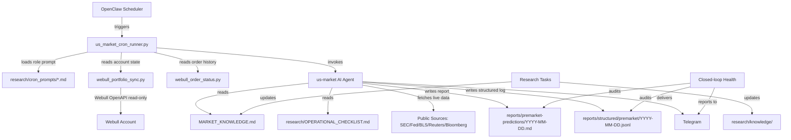

# us-stock-monitor

An automated U.S. equity market intelligence system built on [OpenClaw](https://github.com/openclaw/openclaw). It runs as a dedicated AI agent that collects, analyzes, and delivers structured market reports to your Telegram, covering pre-market preparation, intraday scanning, post-market review, and ongoing academic research.

**This system does not trade automatically.** All buy/sell suggestions are written as drafts that require your explicit approval before any order can be submitted.

---

## What problem does it solve?

Following the U.S. stock market requires collecting information from many scattered sources — SEC filings, Federal Reserve calendars, earnings schedules, price data, broker account snapshots — and synthesizing them before market open each day. This system automates that information gathering and produces structured reports so you can make better-informed decisions faster, without manually checking dozens of sources every morning.

---

## How it works

The system runs as a dedicated OpenClaw agent (`us-market`) with a set of scheduled tasks. Each task runs a Python wrapper script (`scripts/us_market_cron_runner.py`) that invokes the AI agent with a role-specific prompt from `research/cron_prompts/`. The agent reads local workspace files (portfolio state, market knowledge, research history), fetches current information from public sources, and produces a structured report.

Reports are archived locally as Markdown and JSONL files, and optionally delivered to a Telegram chat.

---

## Modules and what each one does

| Module | Schedule | What it produces |
|--------|----------|-----------------|
| **Pre-market Intelligence** (`premarket_prediction`) | Weekdays 09:00 ET | Deep pre-market scan: macro calendar, earnings, SEC filings, abnormal movers, position review, final action summary |
| **Post-market Audit** (`postmarket_audit`) | Weekdays 16:20 ET | Prediction accuracy review, order recap, P&L after fees, decision discipline audit |
| **Closed-loop Health Check** (`closed_loop_health`) | Weekdays 17:05 ET | Verifies all report archives are intact and the pipeline is healthy; alerts if broken |
| **Academic & Market Research** (`research_a`) | Mon/Wed/Fri 20:30 ET | Sources academic papers and first-party data; updates `MARKET_KNOWLEDGE.md` |
| **Weekly Distillation** (`weekly_distillation_b`) | Saturday 10:00 ET | Distills the week's research into durable lessons; runs contradiction audit |
| **Monthly Prompt Evaluation** (`monthly_prompt_eval_c`) | First Sunday 11:00 ET | Evaluates and proposes improvements to agent prompts |
| **Daily Book Learning** (`daily_book_learning_claude`) | Daily 03:00 & 06:00 ET | Reads open-access finance/quant books and extracts verified lessons |
| **Intraday :33 Scan** (`intraday_prediction_33`) | Weekdays :33 each hour | Real-time intraday scan — **disabled by default**, high frequency |
| **Intraday :03 Scan** (`intraday_prediction_03`) | Weekdays :03 each hour | Real-time intraday scan — **disabled by default**, high frequency |

---

## Data flow



---

## What happens automatically vs. what requires your approval

**Automatic (no approval needed):**
- Collecting market data and news from public sources
- Reading your Webull account snapshot (read-only)
- Writing report files to the local workspace
- Sending reports to Telegram

**Requires your explicit approval:**
- Every buy or sell order — the agent writes a draft and waits for you to confirm the exact order before anything is submitted
- Enabling or re-enabling any scheduled task
- Any configuration change

---

## Models and external services used

| Component | Default model | Notes |
|-----------|--------------|-------|
| Market reports | Claude Opus (via Claude CLI OAuth) | Requires Claude Pro subscription |
| Fallback | OpenAI GPT (via OpenAI OAuth) | Optional; requires Codex/ChatGPT subscription |
| Book learning | Claude Sonnet | Separate role, lighter model |

**External services required:**
- [Webull OpenAPI](https://developer.webull.com/) — read-only broker integration (positions, orders, balances)
- [Claude CLI](https://claude.ai/download) — AI inference via Claude Pro subscription
- OpenClaw — the agent runtime and scheduler
- Telegram Bot — for report delivery

---

## Deploying on a new machine

### Prerequisites

1. Install [OpenClaw](https://github.com/openclaw/openclaw) and start the gateway
2. Authenticate Claude CLI: `claude auth login`
3. Clone this repository to your workspace directory
4. Copy `.env.example` to `.webull.env` and fill in your Webull API credentials
5. Create the required output directories:
   ```bash
   mkdir -p reports/{premarket-predictions,postmarket-reviews,intraday-predictions,closed-loop-health,structured/{premarket,postmarket,intraday}}
   mkdir -p research/{logs,daily,weekly,evaluations,queue,knowledge/{cards,domains},calibration}
   ```
6. Create `PORTFOLIO_STATE.md` with your current account baseline (see template below)
7. Install Python dependencies: `pip install -r requirements-webull.txt`

### Step 1: Register the agent

Run `restore/restore-agent.sh` to verify prerequisites and see the agent configuration, then add the agent to OpenClaw:

```json
{
  "id": "us-market",
  "name": "us-market",
  "workspace": "/YOUR/ABSOLUTE/PATH/TO/this-directory",
  "model": {
    "primary": "anthropic/claude-opus-4-8",
    "fallbacks": ["openai/gpt-5.5"]
  },
  "thinkingDefault": "high"
}
```

### Step 2: Configure Telegram delivery

Set `OPENCLAW_TELEGRAM_TARGET` in your environment to your Telegram chat ID, then update the runner script or the cron job definitions in `cron-definitions/all-jobs.json`.

### Step 3: Register scheduled tasks (all disabled by default)

Run `restore/restore-cron-jobs.sh` for a preview of all 9 tasks. Register each job via the OpenClaw gateway:

```bash
# Example: register pre-market task (starts disabled)
openclaw gateway cron.add --job '{ ... see cron-definitions/all-jobs.json ... }'
```

Enable only the tasks you want, one at a time, after verifying credentials work.

### Step 4: Create PORTFOLIO_STATE.md

The agent needs a baseline of your account state. Create `PORTFOLIO_STATE.md` with content like:

```markdown
# Portfolio State — YYYY-MM-DD
Updated: YYYY-MM-DD HH:MM ET

## Cash / Buying Power
- Cash Balance: $X,XXX.XX
- Buying Power: $X,XXX.XX

## Holdings
| Ticker | Shares | Avg Cost | Current Price |
|--------|--------|----------|---------------|
| ...    | ...    | ...      | ...           |

## Account Total Equity
$X,XXX.XX
```

---

## Verifying the setup (no real credentials or paid calls required)

```bash
# Check that the runner script can parse correctly
python3 scripts/us_market_cron_runner.py --help

# Verify Webull credentials are configured (no live trading)
python3 scripts/webull_verify.py

# Dry-run the cron job definitions (prints definitions, does nothing)
bash restore/restore-cron-jobs.sh
```

---

## Security notes

- **Never commit** `.webull.env`, `PORTFOLIO_STATE.md`, `WEBULL_ORDER_STATUS.md`, or any file matching `webull_*_snapshot.json` — they contain private account data.
- Webull API keys are in `.webull.env` only. The `.gitignore` in this repo excludes all private files.
- The `conf/` directory is gitignored — it may contain local runtime tokens.
- OAuth tokens for Claude and OpenAI are managed by OpenClaw and Claude CLI; they are never stored in this workspace.
- Reports in `reports/` and logs in `research/logs/` are gitignored — they may contain your actual position data.

---

## Recovering the system after re-authentication

If Claude or OpenAI OAuth expires:
1. Re-authenticate Claude: `claude auth login`
2. Re-authenticate OpenAI: `openclaw configure` → OpenAI login
3. Verify inference works: `openclaw agent run --agent us-market --message "hello"`
4. Re-enable cron tasks: `openclaw gateway cron.update --jobId <id> --enabled true`

The `claude_token_keeper.py` script (in the main OpenClaw workspace, not this repo) handles automatic Claude token refresh. If it has not run recently, re-run it manually: `python3 /path/to/claude_token_keeper.py --force`

---

## Repository structure

```
.
├── scripts/                    # Python automation scripts
│   ├── us_market_cron_runner.py    # Main cron dispatcher
│   ├── webull_portfolio_sync.py    # Webull read-only account sync
│   ├── webull_order_status.py      # Webull read-only order sync
│   ├── webull_verify.py            # Webull credential check
│   ├── position_math.py            # Position sizing calculator
│   ├── special_event_minute_collect.py  # Event data collector
│   └── ...                         # Supporting tools
├── research/
│   ├── cron_prompts/           # AI agent instructions for each scheduled role
│   ├── OPERATIONAL_CHECKLIST.md    # Trading rules and decision discipline
│   ├── RESEARCH_PROGRAM.md         # Research methodology
│   ├── STRUCTURED_LOG_SCHEMA.md    # JSONL output schema
│   ├── FAILED_IDEAS.md             # Rejected strategies (do not reuse)
│   └── ...
├── cron-definitions/
│   └── all-jobs.json           # Portable cron job definitions (all disabled)
├── restore/
│   ├── restore-agent.sh        # Agent configuration restore script
│   └── restore-cron-jobs.sh    # Cron job review and restore guide
├── AGENTS.md                   # Agent contract and operating rules
├── MARKET_KNOWLEDGE.md         # Durable market research knowledge base
├── .env.example                # Webull credential template
├── requirements-webull.txt     # Python dependencies
└── .gitignore
```
